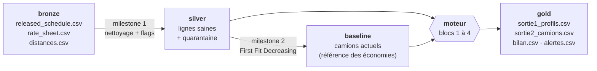
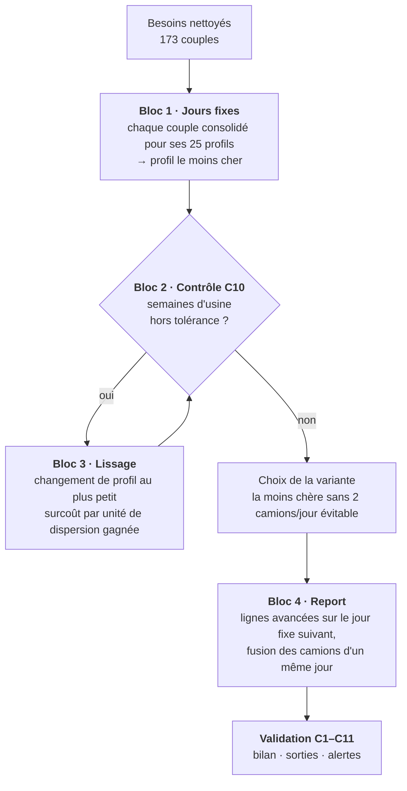
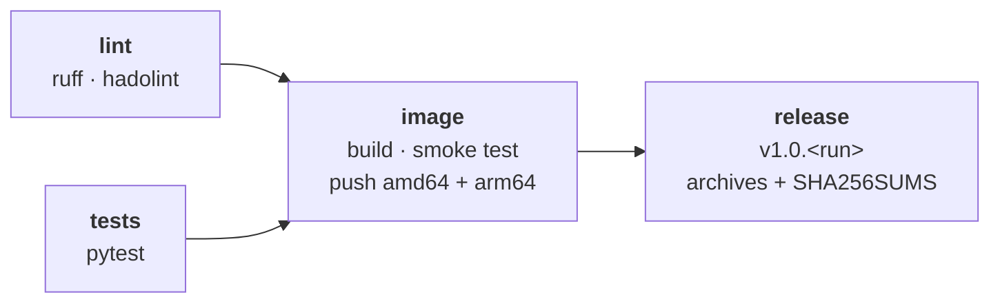

<div align="center">

# 🚚 Fast-n-Fourgon

**Moteur de consolidation des livraisons fournisseurs → usines**

Moins de camions, moins de coût, des jours de livraison fixes et des usines à la charge équilibrée.

<!-- État du projet -->
[](https://github.com/TheKingL/fast-n-fourgon/actions/workflows/ci.yml)
[](https://github.com/TheKingL/fast-n-fourgon/releases/latest)
[](https://github.com/TheKingL/fast-n-fourgon/pkgs/container/fast-n-fourgon)
[](https://github.com/TheKingL/fast-n-fourgon/pkgs/container/fast-n-fourgon)
[](tests/)
[](https://github.com/astral-sh/ruff)
[](https://github.com/hadolint/hadolint)
[](https://github.com/TheKingL/fast-n-fourgon/commits/main)

<!-- Systèmes -->
[](#windows-powershell)
[](#macos)
[](#linux-debian--ubuntu)

<!-- Stack -->
[](https://www.python.org/)
[](https://pandas.pydata.org/)
[](https://numpy.org/)
[](https://streamlit.io/)
[](https://plotly.com/python/)
[](https://openpyxl.readthedocs.io/)
[](data_analysis/)
[](Dockerfile)
[](.github/workflows/ci.yml)
[](https://docs.pytest.org/)
[](https://docs.astral.sh/ruff/)

</div>

---

## Sommaire

- [En bref](#en-bref)
- [La solution](#la-solution)
  - [Le problème](#le-problème)
  - [Les règles à respecter](#les-règles-à-respecter-c1-à-c11)
  - [Le modèle de coût](#le-modèle-de-coût)
  - [Le pipeline de données](#le-pipeline-de-données)
  - [L'algorithme, bloc par bloc](#lalgorithme-bloc-par-bloc)
  - [Résultats sur le schedule du projet](#résultats-sur-le-schedule-du-projet)
  - [Cas impossibles et alertes](#cas-impossibles-et-alertes)
- [Installation](#installation)
- [Lancement](#lancement)
- [Dashboard (Streamlit)](#dashboard-streamlit)
- [Docker](#docker)
- [Tests et lint](#tests-et-lint)
- [CI et releases](#ci-et-releases)
- [Structure du dépôt](#structure-du-dépôt)
- [Utilisation depuis du code](#utilisation-depuis-du-code)

---

## En bref

À partir du *schedule* des besoins (quel material, quel fournisseur, quelle usine, quel jour, quel poids, quel
volume), le moteur construit le plan de transport des semaines à venir : **chaque couple fournisseur × usine reçoit
1 à 3 jours fixes de livraison par semaine**, et ses besoins sont regroupés dans le moins de camions possible, sans
jamais livrer en retard.

| | Situation actuelle (baseline) | Avec Fast-n-Fourgon | Écart |
|---|---:|---:|---:|
| Camions | 1 741 | **787** | **−55 %** |
| Coût de transport | 177 321 € | **116 118 €** | **−61 203 € (−34,5 %)** |
| Semaines d'usine déséquilibrées | 12 / 20 | **2 / 20** | −10 |
| Contraintes dures violées | – | **0** | |

Le tout est livré avec un **dashboard Streamlit** (analyse, historique des runs, saisie des distances manquantes),
une **CLI**, une **image Docker multi-architecture** et une **CI** qui teste, publie l'image et crée une release à
chaque push sur `main`.

---

## La solution

### Le problème

Aujourd'hui, chaque commande (un fournisseur, une usine, un jour) part dans ses propres camions. Un fournisseur qui
livre une usine 3 jours dans la semaine envoie 3 camions, souvent presque vides : le tarif dépend surtout de la
distance, un camion à moitié vide coûte presque autant qu'un camion plein.

L'idée est de **regrouper les besoins de plusieurs jours dans un même camion**, en livrant un peu en avance (jamais en
retard), et de **fixer les jours de livraison** de chaque fournisseur pour que les usines puissent organiser leurs
quais. Il faut en même temps éviter que tous les fournisseurs choisissent le même jour : la charge de chaque usine
doit rester **équilibrée** sur la semaine.

Sur le schedule du projet : **4 255 lignes de besoin**, **173 couples** fournisseur × usine, **4 usines**, des
besoins du 09/11 au 18/12 (6 semaines), avec des livraisons possibles dès le 02/11 (une semaine ajoutée avant le
planning pour pouvoir anticiper les premiers besoins).

### Les règles à respecter (C1 à C11)

Toutes les règles sont vérifiées sur le planning final par [`backend/contraintes.py`](backend/contraintes.py). Une
contrainte dure violée arrête le moteur : un planning qui sort est un planning valide.

| | Règle | Type |
|---|---|:---:|
| **C1** | Un camion ne dépasse pas **24,5 t** | dure |
| **C2** | Un camion ne dépasse pas **110,4 m³** | dure |
| **C3** | Chaque ligne de besoin est livrée, une seule fois, entière | dure |
| **C4** | Un camion ne transporte qu'un seul couple fournisseur × usine | dure |
| **C5** | **Jamais de retard** : livraison au plus tard le jour du besoin | dure |
| **C6** | Au plus **7 jours d'avance** sur le besoin | dure |
| **C7** | Livraison un jour ouvré, dans l'horizon du planning | dure |
| **C8** | Chaque couple a **1 à 3 jours fixes** par semaine, et tous ses camions partent ces jours-là | dure |
| **C9** | Au plus **1 camion par couple et par jour** | dure |
| **C10** | **Lissage** : aucun jour d'une usine ne s'écarte de plus de **35 %** de la moyenne de sa semaine | souple |
| **C11** | Un couple à 2 ou 3 jours fixes livre au moins une semaine sur **tous** ses jours fixes | dure |

> C10 est une contrainte souple : une semaine est « hors tolérance » si un jour s'écarte de la moyenne de plus de
> 35 % **et** d'au moins un camion. Les petites semaines (moins de 5 camions, soit moins d'un par jour) ne sont pas
> contrôlées.

### Le modèle de coût

Le coût d'un camion vient de la grille tarifaire ([`data/bronze/rate_sheet.csv`](data/bronze/rate_sheet.csv)) :
une tranche de distance (30 km … 650 km, puis « > 650 km ») croisée avec une tranche de poids (50 kg … 4 000 kg,
puis « > 4 000 kg »).

```
prix d'un camion = grille[tranche de distance, tranche de poids] × (1 + 239,23 %) × 1,1943
                                                                    marge          surcharge diesel
```

Exemple : `cout_transport(1000, 300)` = **335,34 €** pour 1 000 kg à 300 km.

Quand une donnée manque, le moteur prend une **estimation haute** (comme la baseline) : distance inconnue → tranche
« > 650 km », poids inconnu → tranche « > 4 000 kg ». Les distances manquantes peuvent être complétées dans l'onglet
**Mapping** du dashboard. **L'objectif minimisé est la somme des prix des camions.**

### Le pipeline de données

Le projet suit une architecture en médaillon : chaque étape écrit dans son propre dossier de `data/`.



1. **Nettoyage (milestone 1, [`nettoyage.py`](backend/nettoyage.py))** : retrait des lignes à quantité nulle, à date
   illisible et du faux jour de livraison du 01/01/2027 (il regroupe les besoins anticipés du mois suivant). Chaque
   ligne reçoit ses *flags* (`MISSING_WEIGHT`, `MISSING_VOLUME`, `NO_DISTANCE`, `OVER_TRUCK_WEIGHT`,
   `OVER_TRUCK_VOLUME`) : les lignes sans flag forment le silver « clean », les autres la quarantaine.
2. **Baseline (milestone 2, [`baseline.py`](backend/baseline.py))** : la situation actuelle, reconstruite pour
   mesurer les économies. Une commande = un fournisseur, une usine, un jour ; ses lignes sont rangées par *First
   Fit Decreasing* (de la plus lourde à la plus légère, chacune dans le premier camion où elle rentre).
3. **Lignes sans poids ou sans volume** : impossibles à consolider. Chacune part dans **son propre camion réservé**, le
   jour du besoin (134 camions sur le projet). Elles sont comptées dans tous les coûts, à l'identique pour toutes les
   versions, et signalées par fournisseur dans l'onglet Qualité des données.

### L'algorithme, bloc par bloc



#### Bloc 1 — Jours fixes ([`jours_fixes.py`](backend/jours_fixes.py))

Un **profil** est un ensemble de jours fixes : 5 profils à 1 jour (lundi … vendredi), 10 à 2 jours, 10 à 3 jours,
soit **25 profils**. Comme les couples sont indépendants (C4 : un camion = un couple), le moteur peut **essayer les
25 profils pour chacun des 173 couples** (4 325 consolidations), une seule fois : le lissage et le report réutilisent
ensuite ces scénarios sans rien recalculer.

Pour un couple et un profil, la consolidation est gloutonne :

1. le premier besoin restant ouvre un camion au **dernier jour fixe avant (ou égal à) sa date** — donc toujours
   0 à 6 jours d'avance, jamais de retard ;
2. on y ajoute les besoins suivants, dans l'ordre des dates (puis du plus lourd au plus léger), **tant qu'ils sont à
   moins de 7 jours du camion** et qu'ils tiennent en poids et en volume ; une ligne qui ne rentre pas est sautée et
   la suivante est essayée ;
3. quand plus rien n'entre, le camion est fermé et on recommence avec le premier besoin restant.

> **Exemple** — profil « Mardi », besoins le mer. 11, le ven. 13 et le lun. 16 : un seul camion le mar. 10 transporte
> les trois (1, 3 et 6 jours d'avance), au lieu de trois camions dans la baseline.

Pour chaque couple, on garde le profil **le moins cher** parmi les profils autorisés :

- **C11** : un profil à 2 ou 3 jours où le couple ne livre jamais une semaine sur tous ses jours est écarté ;
- **C9** : si un profil évite 2 camions le même jour, les profils qui en mettent 2 sont écartés ;
- à coût égal : le moins de camions, puis le moins de jours fixes.

Le moteur calcule trois **variantes** (1 jour fixe ; 1 ou 2 ; 1 à 3) pour les comparer dans le bilan.

#### Bloc 2 — Équilibre des usines ([`charge.py`](backend/charge.py))

Le profil le moins cher est très souvent **un seul jour par semaine**, et beaucoup de fournisseurs tombent sur le même
jour : avant lissage, **les 20 semaines contrôlées** (4 usines × 5 semaines) sont hors tolérance. La charge d'une
usine est une matrice *semaines × 5 jours* (camions reçus par jour), réservés compris.

#### Bloc 3 — Lissage ([`lissage.py`](backend/lissage.py))

Usine par usine, tant qu'une semaine est hors tolérance, le moteur évalue **chaque changement de profil possible**
de chaque couple et applique celui qui a le meilleur rapport :

```
critère = max(surcoût, 0) / dispersion gagnée     (le plus petit gagne ; à égalité, la plus grande dispersion gagnée)
```

Un changement gratuit qui équilibre passe donc en premier, et le moteur paie le moins possible chaque unité
d'équilibre. Il s'arrête quand l'usine est dans la tolérance ou qu'aucun changement n'améliore plus la dispersion.
Sur le projet : **101 changements de profil**, pour **~1 250 €** de surcoût, et l'on passe de 20 à **2 semaines hors
tolérance**.

**Choix de la variante** : la moins chère après lissage, parmi celles qui ne mettent jamais 2 camions le même jour
quand un autre profil l'éviterait. La variante « 1 jour fixe » est 2,53 € moins chère, mais oblige un couple à 2 camions
le même jour, là où un 2ᵉ jour fixe l'évite : c'est donc **« 1 ou 2 jours fixes »** qui est retenue.

#### Bloc 4 — Report ([`report.py`](backend/report.py))

Une dernière passe, couple par couple, sur le planning lissé :

1. une ligne dont le besoin tombe **après le jour fixe suivant** peut passer dans le camion de ce jour, s'il a la place
   (moins d'avance, camion mieux rempli) ;
2. deux camions d'un couple **le même jour** sont fusionnés s'ils tiennent dans un seul.

Le résultat n'est gardé que s'il **ne coûte pas plus cher** et que le couple respecte toujours C11. Sur le projet :
172 lignes reportées, 215 € de gain, et l'avance moyenne passe de 3,95 à **3,7 jours**.

#### Validation et sorties ([`contraintes.py`](backend/contraintes.py), [`sorties.py`](backend/sorties.py))

Le planning final (camions optimisés + camions réservés) est contrôlé règle par règle (C1 à C11) et pour sa
cohérence (contenu des camions, poids livré, coût). Le moteur écrit ensuite dans `data/gold/` :

| Fichier | Contenu |
|---|---|
| `sortie1_profils.csv` | **sortie 1** : le profil à appliquer pour chaque couple (jours, fréquence actuelle et cible, camions par semaine, remplissage) |
| `sortie2_camions.csv` | **sortie 2** : les materials chargés dans chaque camion |
| `bilan.csv` | les économies de chaque étape du moteur par rapport à la baseline |
| `alertes.csv` | les cas où une règle ne peut pas être respectée, avec leur cause et l'action à mener |

### Résultats sur le schedule du projet

Bilan complet (camions réservés compris) — chaque ligne est une étape ou une variante du moteur :

| Version | Camions | Coût | Économie | Avance moy. | Semaines hors tolérance |
|---|---:|---:|---:|---:|---:|
| Baseline (situation actuelle) | 1 741 | 177 321 € | – | – | 12 / 20 |
| Algorithme de base (sans jours fixes) | 692 | 109 513 € | 38,2 % | 3,0 j | 20 / 20 |
| 1 jour fixe | 766 | 115 086 € | 35,1 % | 4,0 j | 20 / 20 |
| 1 jour fixe + lissage | 787 | 116 329 € | 34,4 % | 4,0 j | 2 / 20 |
| 1 ou 2 jours fixes + lissage | 787 | 116 332 € | 34,4 % | 3,9 j | 2 / 20 |
| **1 ou 2 jours fixes + lissage + report** (retenue) | **787** | **116 118 €** | **34,5 %** | **3,7 j** | **2 / 20** |

À lire :

- **le prix des jours fixes** : livrer n'importe quel jour (algorithme de base) économiserait 38,2 % ; fixer les
  jours coûte 3 points d'économie, en échange d'un planning régulier pour les fournisseurs et les usines ;
- **le prix du lissage** : moins de 1 point d'économie pour ramener les semaines déséquilibrées de 20 à 2 ;
- 1, 2 ou 3 jours fixes donnent le même résultat avant lissage : avec cette grille, un camion par semaine bien
  rempli est presque toujours le moins cher. Les 2ᵉ et 3ᵉ jours servent au lissage et à éviter 2 camions le même jour.

Économies par usine :

| Usine | Camions (avant → après) | Coût (avant → après) | Économie |
|---|---:|---:|---:|
| PLT_001 | 540 → 223 | 45 310 € → 29 287 € | 16 023 € (35,4 %) |
| PLT_002 | 452 → 237 | 45 491 € → 31 199 € | 14 292 € (31,4 %) |
| PLT_003 | 193 → 112 | 27 932 € → 20 390 € | 7 542 € (27,0 %) |
| PLT_004 | 556 → 215 | 58 588 € → 35 243 € | 23 345 € (39,8 %) |
| **Total** | **1 741 → 787** | **177 321 € → 116 118 €** | **61 203 € (34,5 %)** |

### Cas impossibles et alertes

Certaines règles ne peuvent pas être tenues à cause des données ; le moteur ne les cache pas, il les **notifie** dans
`alertes.csv` avec la cause et l'action à mener (139 cas sur le projet) :

| Règle | Cause | Cas | Action |
|---|---|---:|---|
| C8 : camion hors jours fixes | ligne sans poids (camion réservé le jour du besoin) | 110 | obtenir le poids auprès du client pour pouvoir la consolider |
| C9 : 2 camions le même jour | ligne sans poids (camion réservé) | 25 | idem |
| C9 : 2 camions le même jour | le besoin d'un seul jour dépasse 24,5 t | 4 | aucun profil ne peut l'éviter |

---

## Installation

### Prérequis

| | Windows | macOS | Linux |
|---|---|---|---|
| **Python 3.12** | [python.org](https://www.python.org/downloads/) ou `winget install Python.Python.3.12` | `brew install python@3.12` | `sudo apt install python3.12 python3.12-venv` |
| **Git** | [git-scm.com](https://git-scm.com/download/win) ou `winget install Git.Git` | `xcode-select --install` ou `brew install git` | `sudo apt install git` |
| **Docker** *(optionnel)* | [Docker Desktop](https://www.docker.com/products/docker-desktop/) | [Docker Desktop](https://www.docker.com/products/docker-desktop/) (Intel ou Apple Silicon) | [Docker Engine](https://docs.docker.com/engine/install/) |

> Pour seulement utiliser le dashboard, **Docker suffit** : pas besoin de Python ni de Git (voir [Docker](#docker)).

### Windows (PowerShell)

```powershell
git clone https://github.com/TheKingL/fast-n-fourgon.git
cd fast-n-fourgon
py -3.12 -m venv .venv
.\.venv\Scripts\Activate.ps1
pip install -r requirements-dev.txt
```

Si PowerShell refuse d'activer le venv (« l'exécution de scripts est désactivée ») :
`Set-ExecutionPolicy -Scope CurrentUser RemoteSigned`, puis relancer l'activation. Sous `cmd.exe`, activer avec
`.venv\Scripts\activate.bat`.

### macOS

```bash
git clone https://github.com/TheKingL/fast-n-fourgon.git
cd fast-n-fourgon
python3.12 -m venv .venv
source .venv/bin/activate
pip install -r requirements-dev.txt
```

### Linux (Debian / Ubuntu)

```bash
git clone https://github.com/TheKingL/fast-n-fourgon.git
cd fast-n-fourgon
python3.12 -m venv .venv
source .venv/bin/activate
pip install -r requirements-dev.txt
```

Sur une distribution sans Python 3.12 dans ses dépôts, [pyenv](https://github.com/pyenv/pyenv) ou
[uv](https://docs.astral.sh/uv/) (`uv venv --python 3.12`) l'installent sans toucher au Python du système.

### Quelles dépendances ?

| Fichier | Contenu | Pour qui |
|---|---|---|
| [`requirements.txt`](requirements.txt) | moteur et dashboard : pandas, NumPy, Streamlit, Plotly, openpyxl | faire tourner l'application (c'est ce qu'installent l'image Docker et `lancer_dashboard.bat`) |
| [`requirements-dev.txt`](requirements-dev.txt) | `requirements.txt` + pytest, Ruff, Jupyter, ipytest, matplotlib, nbdime, nbstripout | développer : tests, lint, notebooks |

Toutes les versions sont épinglées : un même `pip install` donne le même environnement sur les trois systèmes.

---

## Lancement

Depuis la racine du dépôt, venv activé (mêmes commandes sous Windows, macOS et Linux) :

```bash
python main.py                          # calcule, écrit les sorties dans data/gold/ et affiche le résumé
python main.py 254                      # idem, en détaillant le camion n° 254
python main.py --schedule planning.csv  # nettoie et consolide un autre schedule brut
```

Sans `--schedule`, le moteur lit les fichiers déjà préparés par les notebooks (`data/silver`, `data/baseline`). Avec
`--schedule`, il fait tout le chemin depuis le fichier brut : nettoyage, baseline, consolidation. Sur
`data/bronze/released_schedule.csv`, les deux donnent exactement les mêmes résultats. Un calcul complet prend environ
8 secondes.

---

## Dashboard (Streamlit)

| Windows | macOS / Linux |
|---|---|
| double-clic sur `lancer_dashboard.bat` (utilise `.venv` s'il existe et installe `requirements.txt` si besoin), ou `streamlit run frontend/app.py` | `streamlit run frontend/app.py` (venv activé) |

Le dashboard s'ouvre sur <http://localhost:8501>. Trois pages :

- **Analyse** : on choisit un schedule (celui du projet ou un CSV importé), on lance le moteur, on voit les résultats
  (coût, économie, camions, charge des usines, sorties 1, 2 et 3, contraintes) et l'écart avec le dernier run ;
  « Exporter l'analyse » télécharge les trois sorties et la synthèse, en classeur Excel (une feuille par sortie) ou en
  CSV zippés (format Excel français ou format `data/gold`) ; « Enregistrer dans l'historique » garde le run.
  L'onglet **Qualité des données** liste, fournisseur par fournisseur, les lignes sans poids ou sans volume
  (impossibles à consolider) ;
- **Historique** : évolution des métriques run après run (avec un mode base 100), comparaison de deux runs, journal,
  fichiers de chaque run ;
- **Mapping** : table de correspondance fournisseur → distance, pour compléter les distances manquantes (sinon
  chiffrées au tarif « > 650 km »). Les saisies sont gardées dans `data/mapping/distances_saisies.csv` (local à
  chaque poste, ignoré par git) sans modifier `data/bronze/distances.csv`, et le moteur les utilise à l'analyse
  suivante (`main.py` compris) ; le fichier des distances complété peut être téléchargé.

Un CSV importé doit avoir les colonnes de `data/bronze/released_schedule.csv`. Le résultat d'un même fichier est gardé
en cache tant que le serveur tourne. Les runs sont gardés dans `data/historique/` (local à chaque poste, ignoré par
git).

---

## Docker

Le dashboard tourne aussi dans un conteneur, sans installer Python. Le CI publie l'image sur
[`ghcr.io/thekingl/fast-n-fourgon`](https://github.com/TheKingL/fast-n-fourgon/pkgs/container/fast-n-fourgon) à chaque
push sur `main`, pour **amd64** (PC Windows ou Linux, Mac Intel) et **arm64** (Mac Apple Silicon, Raspberry Pi 4/5,
serveurs ARM) : Docker choisit tout seul la bonne architecture.

**bash / zsh (macOS, Linux)**

```bash
docker run -d --name fast-n-fourgon -p 8501:8501 \
  -v fast-n-fourgon-historique:/app/data/historique \
  -v fast-n-fourgon-mapping:/app/data/mapping \
  ghcr.io/thekingl/fast-n-fourgon:latest
```

**PowerShell (Windows)**

```powershell
docker run -d --name fast-n-fourgon -p 8501:8501 `
  -v fast-n-fourgon-historique:/app/data/historique `
  -v fast-n-fourgon-mapping:/app/data/mapping `
  ghcr.io/thekingl/fast-n-fourgon:latest
```

Le dashboard est alors sur <http://localhost:8501> ; `docker stop fast-n-fourgon` l'arrête, `docker start
fast-n-fourgon` le relance.

**Avec docker compose**, depuis le dépôt :

```bash
docker compose up -d                           # image publiée sur ghcr.io
docker compose up -d --build                   # image construite depuis les sources
docker compose pull && docker compose up -d    # passer à la dernière image publiée
docker compose down                            # arrêt (historique et mapping restent dans les volumes)
```

> **Linux** : sans Docker Desktop, préfixer les commandes par `sudo`, ou ajouter son utilisateur au groupe `docker`
> (`sudo usermod -aG docker $USER`, puis se reconnecter).

- **Historique** : les runs enregistrés vont dans le volume `fast-n-fourgon-historique` (monté sur
  `/app/data/historique`), qui survit à l'arrêt et à la suppression du conteneur.
- **Mapping** : les distances saisies vont dans le volume `fast-n-fourgon-mapping` (monté sur `/app/data/mapping`).
- **Exports** : « Exporter l'analyse » et les boutons « Télécharger » passent par le navigateur, comme en local.
- **Moteur en ligne de commande** : les CSV de sortie arrivent dans le dossier monté sur `/app/data/gold` (ici
  `sorties/`, à créer avant ; sous Linux, ajouter `--user "$(id -u):$(id -g)"` s'il n'appartient pas à l'uid 1000).
  `${PWD}` fonctionne sous bash, zsh et PowerShell :

  ```bash
  docker run --rm -v "${PWD}/sorties:/app/data/gold" ghcr.io/thekingl/fast-n-fourgon python main.py
  docker run --rm -v "${PWD}/sorties:/app/data/gold" -v "${PWD}:/travail" ghcr.io/thekingl/fast-n-fourgon python main.py --schedule /travail/planning.csv
  ```

- **Sans accès à ghcr.io** : chaque [release](https://github.com/TheKingL/fast-n-fourgon/releases) contient l'image en
  archive, à charger avec `docker load -i fast-n-fourgon-<version>-linux-amd64.tar.gz` (`arm64` pour un Mac Apple
  Silicon), puis la commande `docker run` ci-dessus avec le tag `<version>` à la place de `latest`. Le fichier
  `SHA256SUMS` donne l'empreinte de chaque archive.

**L'image** ([`Dockerfile`](Dockerfile)) part de `python:3.12-slim` en deux étages : les dépendances de
`requirements.txt` sont installées dans un venv allégé (sans pip, ni les tests embarqués des librairies, ni les
modules de pyarrow inutilisés), puis copiées avec le code. Elle pèse environ **160 Mo à télécharger** (555 Mo sur
disque), tourne avec un **utilisateur sans droits root** (uid 1000) et à l'heure de Paris (`-e TZ=...` pour changer),
et Docker surveille l'état du dashboard (`HEALTHCHECK`).

---

## Tests et lint

Depuis la racine du dépôt, avec `requirements-dev.txt` installé :

```bash
pytest          # 106 tests du moteur (dossier tests/), quelques secondes
ruff check .    # lint du code Python (configuration dans pyproject.toml)
```

| Fichier | Ce qui est testé |
|---|---|
| [`test_unitaires.py`](tests/test_unitaires.py) | les briques : tranches et coût, date des camions, jour fixe suivant, consolidation d'un couple (capacité, fenêtre de 7 jours), écart et tolérance de lissage |
| [`test_contraintes.py`](tests/test_contraintes.py) | les contraintes C1 à C11 sur le planning final, et la détection d'un planning volontairement faux |
| [`test_exhaustivite.py`](tests/test_exhaustivite.py) | aucune ligne oubliée ni doublée, quantité exacte par material, poids total conservé, anticipation des besoins |
| [`test_cas_limites.py`](tests/test_cas_limites.py) | données manquantes et cas limites : ligne trop lourde, poids ou distance manquants, quantité nulle, couple à une seule ligne, semaine ajoutée avant le planning |
| [`test_livrables.py`](tests/test_livrables.py) | structure et valeurs des sorties 1 et 2, fichiers de `data/gold` à jour |
| [`smoke_image.py`](tests/smoke_image.py) | l'image Docker : moteur, dashboard, exports, historique (lancé par le CI) |

Les tests sont ceux du notebook `data_analysis/milestone4.ipynb` (lancés là-bas avec ipytest). Les notebooks ne sont
pas lintés.

---

## CI et releases

Le workflow [`.github/workflows/ci.yml`](.github/workflows/ci.yml) (GitHub Actions) tourne à chaque push sur `main` :



1. **lint** : `ruff check .` et hadolint sur le `Dockerfile` ;
2. **tests** : `pytest` ;
3. **image** : construction de l'image, puis un smoke test avant toute publication. Le moteur tourne dans le
   conteneur, `tests/smoke_image.py` déroule le dashboard (analyse du schedule du projet, exports, historique) et le
   serveur doit répondre. L'image est ensuite publiée pour amd64 et arm64 sur
   [ghcr.io/thekingl/fast-n-fourgon](https://github.com/TheKingL/fast-n-fourgon/pkgs/container/fast-n-fourgon), avec
   les tags `latest`, `v1.0.<numéro du run>` et `sha-<commit>` ;
4. **release** : une [release](https://github.com/TheKingL/fast-n-fourgon/releases) `v1.0.<numéro du run>` avec
   l'image en archive pour chaque architecture (`docker load`) et leurs empreintes (`SHA256SUMS`).

Sur une pull request vers `main`, seuls le lint et les tests tournent. Les versions sont créées par le CI : pas de tag
à poser à la main. Pour un commit qui ne touche pas l'application (documentation…), `[skip ci]` dans le message évite
une release identique à la précédente.

---

## Structure du dépôt

```
main.py              flux d'exécution : executer() -> exporter() -> afficher()
backend/             le moteur (un module par étape)
  config.py          chemins des fichiers et paramètres (capacités, fenêtre, seuil de lissage...)
  typage.py          alias de types : Profil, Couple, Choix, Charge...
  formatage.py       mise en forme des nombres (format français)
  couts.py           grille tarifaire, distances, coût d'un camion
  nettoyage.py       milestone 1 : schedule brut -> lignes saines + quarantaine (flags)
  baseline.py        milestone 2 : camions de la situation actuelle (la référence des économies)
  donnees.py         entrée du moteur : besoins à consolider, camions réservés, baseline, horizon (charger())
  charge.py          camions reçus par jour et par usine, tolérance de lissage
  contraintes.py     vérification des contraintes C1 à C11 et cohérence du planning
  jours_fixes.py     bloc 1 : consolidation de chaque couple pour chaque profil (classe Scenarios)
  lissage.py         blocs 2 et 3 : équilibre des usines et lissage
  report.py          bloc 4 : report sur le jour fixe suivant, planning final
  sorties.py         bilan, sortie 1, sortie 2, sortie 3 (saving par couple), export CSV
  resultats.py       dataclass Resultats, retournée par main.executer()
frontend/            dashboard Streamlit
  app.py             point d'entrée et navigation
  vues/              les trois pages : analyse.py, historique.py, mapping.py
  moteur.py          lecture du schedule, appel du moteur, métriques d'un run
  historique.py      historisation des runs (data/historique/)
  comparaison.py     comparaison des métriques de deux runs
  export.py          export des 3 sorties : classeur Excel ou CSV zippés
  graphiques.py      graphiques Plotly
  composants.py      bandeau, titres de section, pastilles
  style.py           palette et feuille de style
.streamlit/          thème du dashboard
data/                bronze (brut), silver (nettoyé), baseline, gold (sorties), test (schedule de test)
data_analysis/       notebooks des milestones 1 à 4 (milestone4 = tests du moteur)
tests/               tests pytest du moteur et smoke test de l'image Docker (smoke_image.py)
specs/               énoncé, présentation du projet et grille tarifaire
lancer_dashboard.bat lancement du dashboard sous Windows
requirements.txt     dépendances de l'application ; requirements-dev.txt : tests, lint et notebooks en plus
pyproject.toml       configuration de pytest et de ruff
Dockerfile           image Docker du dashboard ; .dockerignore : ce qui entre dans l'image
compose.yaml         lancement de l'image avec docker compose (port 8501, volumes historique et mapping)
.github/             CI (workflows/ci.yml) et modèle des notes de release
```

Tous les paramètres métier (capacités, fenêtre d'avance, nombre de jours fixes, seuil de lissage, marge, surcharge
diesel) sont dans [`backend/config.py`](backend/config.py). Toutes les fonctions sont typées et documentées : leur
docstring décrit les paramètres et le résultat.

---

## Utilisation depuis du code

`main.executer()` fait tout le calcul sans rien écrire ni afficher, et retourne un objet `Resultats` :

```python
import main

r = main.executer()        # données du projet ; environ 8 secondes : à appeler une fois puis à réutiliser
r = main.executer(df)      # un schedule brut (DataFrame au format de released_schedule.csv)
r.planning_complet         # une ligne par camion (date, usine, fournisseur, poids, coût...)
r.lignes_complet           # une ligne par ligne de besoin livrée (camion, date de livraison, avance)
r.sortie1, r.sortie2       # les deux sorties
r.bilan, r.par_usine       # économies totales et par usine
r.controle_contraintes     # nombre de violations de chaque contrainte
r.alertes                  # cas impossibles notifiés
```

Les fonctions du backend s'appellent aussi directement :

```python
from backend.couts import cout_transport
from backend.sorties import detail_camion

cout_transport(1000, 300)            # 335.34 € : 1 000 kg à 300 km
resume, table = detail_camion(r.sortie2, 254)
```

Le script ou le notebook doit être lancé depuis la racine du dépôt ; depuis `data_analysis/`, ajouter
`sys.path.insert(0, "..")` avant les imports.
